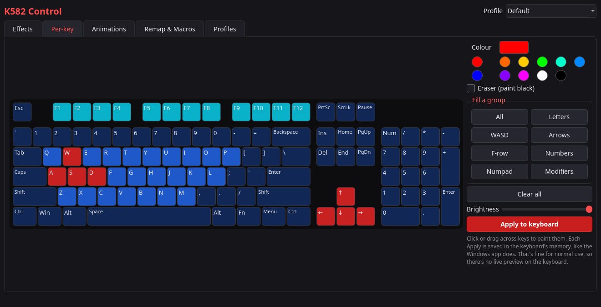
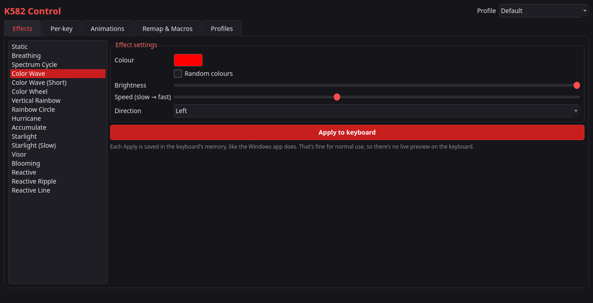
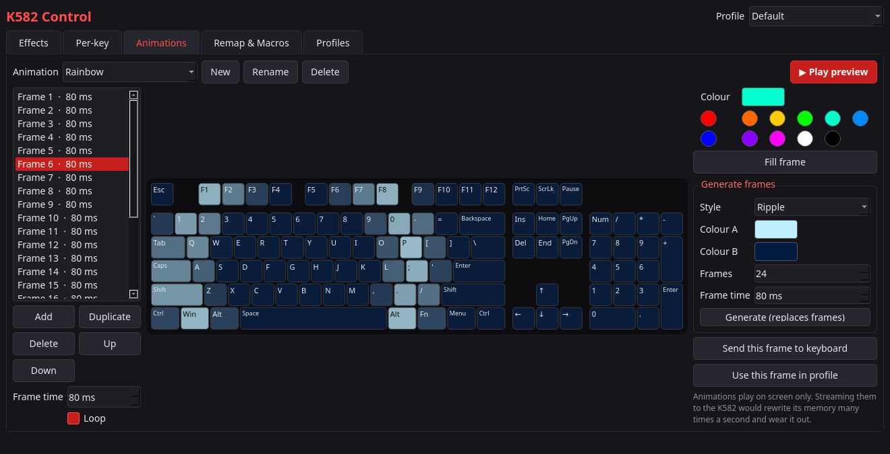
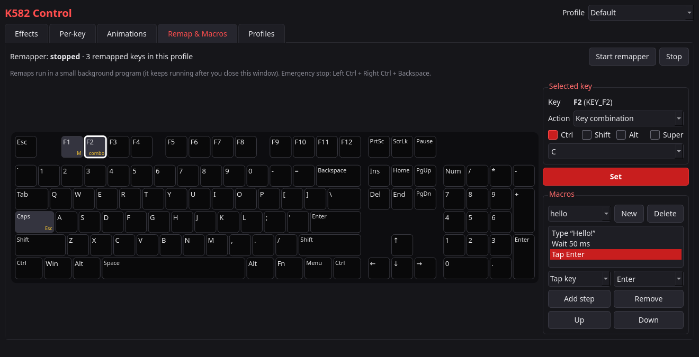
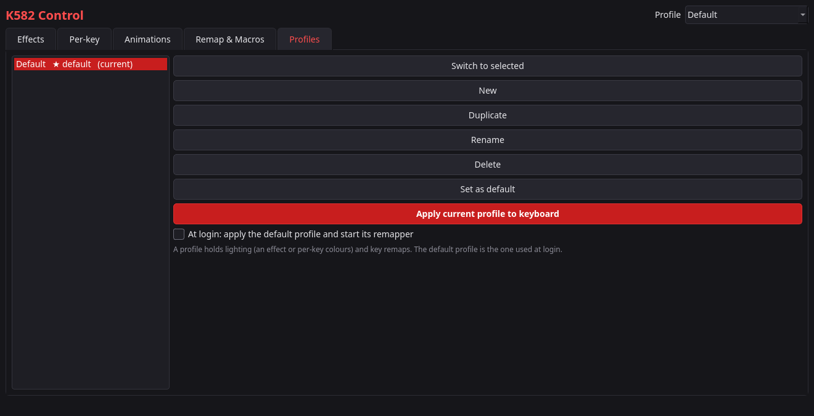

# K582 Control

**Linux RGB lighting, per-key colours, key remapping and macros for the Redragon K582 SURARA keyboard.**

Redragon only ships its configuration software for Windows. K582 Control does the same job on Linux. It's a Qt desktop app that talks to the keyboard's own USB protocol directly, so it needs no Windows, no Wine and no OpenRGB.



## Features

| | |
|---|---|
| **Effects** | All 17 built-in lighting effects (Static, Breathing, Colour Wave, Reactive Ripple, Starlight, …) with colour, random colours, brightness, speed and direction |
| **Per-key colours** | Click or drag to paint any of the 126 keys, fill groups (WASD, arrows, F-row, numpad, …) in one click |
| **Animations** | Make frame-by-frame animations or generate them (rainbow sweep, two-colour wave, pulse, ripple), preview them on screen, send any frame to the keyboard |
| **Remaps & macros** | Make any key send another key, a key combination, a macro (keys, delays, typed text) or a command, or turn it off |
| **Profiles** | Save several setups, switch between them, apply your default automatically at login |
| **Command line** | Script everything: `k582ctl effect "color wave" --color 00ff88` |

<table>
  <tr>
    <td></td>
    <td></td>
  </tr>
  <tr>
    <td></td>
    <td></td>
  </tr>
</table>

## Supported hardware

- **Redragon K582 SURARA**, USB ID `320F:5000` (EVision controller)

To check yours, run `lsusb | grep 320f`. Other EVision-based keyboards with the same USB ID may work but are untested.

## Requirements

- Linux with udev (tested on CachyOS / Arch)
- Python 3.10+
- [PySide6](https://pypi.org/project/PySide6/) (Qt 6) for the app
- [python-evdev](https://pypi.org/project/evdev/) for remapping and macros

## Installation

### Arch Linux, CachyOS, Manjaro, EndeavourOS (AUR)

[](https://aur.archlinux.org/packages/k582-control)

```sh
yay -S k582-control        # or: paru -S k582-control
```

Then unplug the keyboard and plug it back in once, and open **K582 Control** from your app menu or run `k582ctl`.
The package installs the udev rule for you, so there's nothing else to set up.

### Other distributions (from source)

Install PySide6 and python-evdev with your package manager:

| Distribution | Command |
|---|---|
| Debian / Ubuntu | `sudo apt install python3-pyside6.qtwidgets python3-evdev` |
| Fedora | `sudo dnf install python3-pyside6 python3-evdev` |

Then:

```sh
git clone https://github.com/L4FeeR/k582-control.git
cd k582-control
./install.sh
```

`install.sh` does three things:

1. On Arch-based systems, installs `pyside6` and `python-evdev` if they're missing.
2. Installs a udev rule (`packaging/60-k582.rules`) so you can use the keyboard without root. This step asks for your password.
3. Adds **K582 Control** to your app menu.

Then unplug the keyboard and plug it back in once, and open **K582 Control** from your app menu or run `./k582ctl.sh`.

## Command line

With the AUR package, the command is `k582ctl`. From a source checkout, use `./k582ctl.sh`.

```sh
./k582ctl.sh                                    # open the app
./k582ctl.sh effects                            # list the built-in effects
./k582ctl.sh effect static --color ff0000
./k582ctl.sh effect "reactive ripple" --color 88ddff --speed 1
./k582ctl.sh effect "color wave" --color 00ff88 --direction right --brightness 3
./k582ctl.sh apply Gaming                       # apply a profile's lighting
./k582ctl.sh remap Gaming                       # run a profile's remaps (Ctrl+C to stop)
```

Brightness goes from `0` (off) to `4` (full). Speed goes from `0` (fastest) to `5` (slowest).

## How remapping works

The K582 doesn't store remaps itself, so remapping runs in software:

- A small background program grabs the K582's key events and sends the remapped keys through a virtual keyboard (Linux `uinput`).
- It only affects the K582. Other keyboards, such as a laptop's built-in one, are untouched.
- It keeps running after you close the window. Start and stop it from the **Remap & Macros** tab.
- **Emergency stop: Left Ctrl + Right Ctrl + Backspace.** If the program exits for any reason, the keyboard goes straight back to normal.
- Macros type text using the US keyboard layout.
- **Fn** is handled inside the keyboard and can't be remapped.

## Good to know

- **Every lighting change is saved to the keyboard's flash memory.** It's the same as clicking Apply in the Windows app, and fine for normal use. It's also why animations are previewed on screen and not streamed to the keyboard: streaming would rewrite the flash many times a second and wear it out. Built-in effects like *Reactive Ripple* run inside the keyboard and are always safe.
- Don't run OpenRGB at the same time; both would try to control the keyboard.
- The udev rule lets programs running as your user read the K582's key presses and create a virtual keyboard. Tools like Input Remapper need the same access.
- If a key lights up in the wrong place, its LED number is wrong in [`k582ctl/layout.py`](k582ctl/layout.py). Please open an issue or a pull request.

Settings, profiles, macros and animations are stored in `~/.config/k582-control/`.

## Uninstall

**AUR package:**

```sh
sudo pacman -Rns k582-control
```

**Installed from source:**

```sh
sudo rm /etc/udev/rules.d/60-k582.rules
rm ~/.local/share/applications/k582-control.desktop
```

**Either way**, you can also remove the login autostart and your settings:

```sh
rm ~/.config/autostart/k582-control.desktop
rm -r ~/.config/k582-control        # your profiles, macros and animations
```

## Protocol

The keyboard is controlled through 64-byte HID output reports on USB interface 1 (vendor usage page `0xFF1C`):

```
byte  0      0x04         report ID
bytes 1–2    checksum     little-endian 16-bit sum of bytes 3..63
byte  3      command      0x01 begin · 0x02 end · 0x06 set parameter · 0x11 per-key colours
byte  4      length       number of data bytes
bytes 5–6    offset       little-endian
bytes 8+     data
```

- **Set parameter** (offset 0) carries `mode, brightness, speed, direction, random, R, G, B`.
- **Per-key colours** sends 126 × RGB in 7 chunks of 54 bytes.
- The keyboard echoes every packet back as an acknowledgement.

The protocol was confirmed with USB captures of the official Windows software. Mode numbers and the LED matrix come from OpenRGB's EVision driver. The capture notes and the original analysis script are in [`research/`](research/).

## Project layout

```
k582ctl/
  device.py      USB HID driver (packets, checksum, hidraw I/O)
  effects.py     built-in effect table
  layout.py      physical key layout, LED numbers, Linux key codes
  lighting.py    applies profiles, generates animations
  profiles.py    profile / macro / animation storage
  remapd.py      key remapper and macro engine (evdev + uinput)
  cli.py         command line
  gui/           Qt (PySide6) app
packaging/       udev rule, desktop entry, AUR PKGBUILD
research/        protocol capture notes
```

## Credits

- [OpenRGB](https://gitlab.com/CalcProgrammer1/OpenRGB) by Adam Honse and contributors, for documenting the EVision keyboard protocol.

## License

GPL-2.0-or-later. This project builds on protocol details from OpenRGB, which uses the same license.

*Not affiliated with or endorsed by Redragon. "Redragon" and "K582" are trademarks of their respective owners.*
